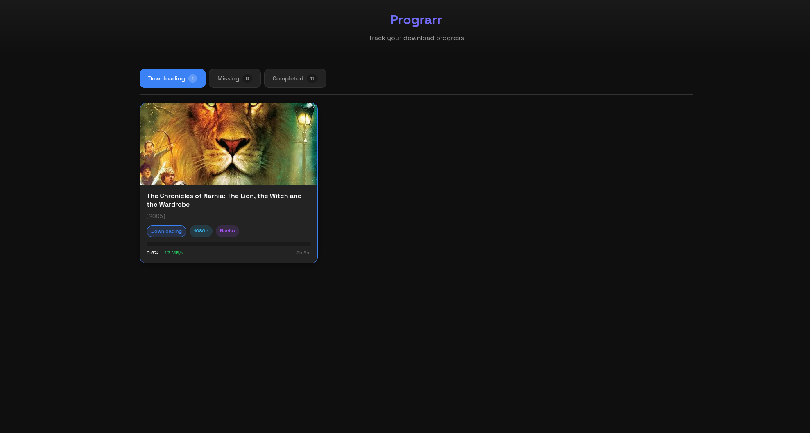

# Prograrr

A lightweight dashboard that aggregates and displays real-time download progress from your *arr stack (Sonarr, Radarr) combined with Jellyseerr requests and qBittorrent/SABnzbd status.




## Features

- Unified view of all media requests from Jellyseerr
- Real-time download progress from Sonarr/Radarr queues
- Torrent status and speed from qBittorrent
- Usenet download progress from SABnzbd

## How It Works

Prograrr aggregates data from multiple services to provide a complete view of your media downloads:

| Service | Data Provided |
|---------|---------------|
| **Jellyseerr** | Requests list, requester, request status, media metadata (title, poster, TMDB/TVDB IDs) |
| **Sonarr** | TV show download queue, TVDB ID, download hash |
| **Radarr** | Movie download queue, TMDB ID, download hash |
| **qBittorrent** | Download progress %, speed, ETA, torrent state |
| **SABnzbd** | Usenet download progress %, speed, ETA, state |

**Data flow:**
```
Jellyseerr (request info: title, poster, who requested)
    ↓ matched by TMDB/TVDB ID
Sonarr/Radarr (queue item with download hash)
    ↓ matched by hash
qBittorrent / SABnzbd (real-time progress, speed, ETA)
```

Jellyseerr, Sonarr/Radarr, and at least one download client (qBittorrent or SABnzbd) are required. Both download clients can be used together.

## Quick Start

Copy `.env.example` to `.env`, fill in your URLs and keys, then:

```bash
docker run -d --name prograrr -p 3000:3000 --env-file .env ignacioavecilla/prograrr:latest
```

## Docker Compose Integration

Add Prograrr to your existing *arr stack `docker-compose.yml`, next to a `.env` file based on `.env.example`:

```yaml
services:
  # ... your existing services (sonarr, radarr, jellyseerr, etc.)

  prograrr:
    image: ignacioavecilla/prograrr:latest
    container_name: prograrr
    env_file: .env
    ports:
      - "3000:3000"
    restart: unless-stopped
```

### Using with VPN Container (Gluetun)

If your *arr apps run through a VPN container like Gluetun, point their URLs at the VPN container in `.env`:

```bash
SONARR_URL=http://gluetun:8989
RADARR_URL=http://gluetun:7878
QBITTORRENT_URL=http://gluetun:8080
```

## Environment Variables

Unset and empty values are treated the same. Service URLs have no defaults.

| Variable | Required | Description |
|----------|----------|-------------|
| `PROGRARR_API_KEY` | **Yes**, unless auth is off | The `X-Api-Key` header for API clients. Also the browser login when no username/password is set |
| `PROGRARR_USERNAME`, `PROGRARR_PASSWORD` | No | Browser login. Set both, or neither to log in with the API key |
| `PROGRARR_AUTH` | No | Set to `false` to disable auth entirely (default `true`). Only do this on a network you trust |
| `JELLYSEERR_URL`, `JELLYSEERR_API_KEY` | **Yes** | Jellyseerr / Overseerr |
| `SONARR_URL`, `SONARR_API_KEY` | **Yes** | Sonarr |
| `RADARR_URL`, `RADARR_API_KEY` | **Yes** | Radarr |
| `QBITTORRENT_URL`, `QBITTORRENT_USERNAME`, `QBITTORRENT_PASSWORD` | One client | qBittorrent Web UI. Enabled when `QBITTORRENT_URL` is set |
| `SABNZBD_URL`, `SABNZBD_API_KEY` | One client | SABnzbd. Enabled when `SABNZBD_URL` is set |
| `PORT` | No | Port the web server listens on (default `3000`) |
| `CORS_ORIGIN` | No | Allow cross-origin API access from this origin (blocked when unset) |
| `TZ` | No | Timezone (default `UTC`) |

At least one download client (qBittorrent or SABnzbd) must be configured; both can be used together.

## Accessing Prograrr From Outside Your Home

Prograrr serves plain HTTP. To use it from your phone away from home, put something in front of it that handles encryption, instead of forwarding port 3000 directly.

### Option 1: Tailscale (easiest)

Install [Tailscale](https://tailscale.com/) on the server and on your phone, then open `http://<server-tailscale-name>:3000`. Nothing is exposed to the internet and no ports need forwarding. Since only your devices can reach it, `PROGRARR_AUTH=false` is reasonable here.

### Option 2: A public URL with HTTPS (Caddy)

[Caddy](https://caddyserver.com/) gets and renews an HTTPS certificate automatically. Point a domain at your home IP, forward ports 80 and 443 to Caddy, and use this `Caddyfile`:

```
prograrr.yourdomain.com {
    reverse_proxy prograrr:3000
}
```

Keep auth enabled (the default), use a long random `PROGRARR_API_KEY` (for example from `openssl rand -hex 32`) and a strong password that you don't use anywhere else.

### Logging in

The web UI asks for `PROGRARR_USERNAME` and `PROGRARR_PASSWORD`, or for `PROGRARR_API_KEY` when those aren't set. The server then sets a signed session cookie that lasts 30 days. The cookie is `HttpOnly` (page scripts can't read it) and `SameSite=Strict`, and it's marked `Secure` whenever the request came over HTTPS, directly or through a proxy that sends `X-Forwarded-Proto`. Changing the API key, username or password logs out every browser.

After 5 login attempts from the same IP within 15 minutes, further attempts are rejected until the 15 minutes are up. Behind a reverse proxy every request comes from the proxy's IP, so a lockout applies to everyone at once.

On iOS or Android you can use "Add to Home Screen" to open Prograrr like an app.

## Getting API Keys

### Jellyseerr
1. Open Jellyseerr and go to **Settings**
2. Click on **General**
3. Copy the **API Key** or generate a new one

### Sonarr
1. Open Sonarr and go to **Settings** > **General**
2. Under **Security**, copy the **API Key**

### Radarr
1. Open Radarr and go to **Settings** > **General**
2. Under **Security**, copy the **API Key**

### qBittorrent
1. Open qBittorrent and go to **Options** > **Web UI**
2. Ensure **Web User Interface** is enabled
3. Note the username and password configured

### SABnzbd
1. Open SABnzbd and go to **Config** > **General**
2. Copy the **API Key** (full access)

## API Endpoints

All data endpoints require either the `X-Api-Key` header matching your `PROGRARR_API_KEY`, or the browser session cookie (unless `PROGRARR_AUTH=false`).

| Endpoint | Description |
|----------|-------------|
| `GET /api/requests` | Returns aggregated media requests with download status. Supports `?tmdbId=` filter |
| `GET /api/overview` | Returns processed, ready-to-render data split into downloading and missing categories |
| `GET /api/health` | Health check endpoint |
| `GET /api/session` | `{authRequired, authenticated, loginMethod}` for the current request, where `loginMethod` is `"password"` or `"apiKey"` (no auth needed) |
| `POST /api/login` | Body `{"username": "...", "password": "..."}`, or `{"apiKey": "..."}` when no username/password is set. Sets the session cookie on success, `401` on wrong credentials, `429` when locked out |
| `POST /api/logout` | Clears the session cookie |
| `GET /api/debug` | Connection status (ok + item count, error, or disabled) for each service |

### `GET /api/overview`

A processed endpoint designed for client integrations (e.g. Jellyfin plugins). Returns two categories *downloading* (active downloads) and *missing* (not found / not available), with TV shows merged into single entries and episodes grouped by season.

Key behaviors:
- **Movies** have top-level `progress`/`speed`/`eta`/`quality` fields; `seasons` is `[]`
- **TV shows** have per-season aggregates (avg progress, total speed, max ETA) with per-episode detail; top-level progress fields are `null`
- Multiple Jellyseerr requests for different seasons of the same series are merged into one entry
- Completed/seeding episodes are filtered out, only active downloads are shown.
- `effectiveStatus` reflects the best status across all episodes (`downloading` > `paused` > `queued` > `stalled`)

Response shape:

```json
{
  "downloading": [
    {
      "title": "The Simpsons",
      "mediaType": "tv",
      "posterUrl": "https://image.tmdb.org/t/p/w500/...",
      "year": 1989,
      "requestedBy": "nacho",
      "effectiveStatus": "downloading",
      "progress": null,
      "speed": null,
      "eta": null,
      "quality": null,
      "seasons": [
        {
          "seasonNumber": 4,
          "episodeCount": 2,
          "progress": 45.5,
          "speed": 5242880,
          "eta": 3600,
          "episodes": [
            {
              "episodeNumber": 3,
              "title": "Homer the Heretic",
              "progress": 45.5,
              "speed": 5242880,
              "eta": 3600,
              "status": "downloading",
              "quality": "1080p"
            }
          ]
        }
      ]
    },
    {
      "title": "Sinners",
      "mediaType": "movie",
      "posterUrl": "...",
      "year": 2025,
      "requestedBy": "nacho",
      "effectiveStatus": "downloading",
      "progress": 72.3,
      "speed": 3145728,
      "eta": 900,
      "quality": "1080p",
      "seasons": []
    }
  ],
  "missing": [
    {
      "title": "Send Help",
      "mediaType": "movie",
      "posterUrl": "...",
      "year": 2026,
      "requestedBy": "nacho",
      "effectiveStatus": null,
      "progress": null,
      "speed": null,
      "eta": null,
      "quality": null,
      "seasons": []
    }
  ]
}
```

## Security

Prograrr is designed to never expose your credentials:

- **No credentials in API responses**: API keys and passwords are only used server-side to connect to your services. They are never included in any JSON response.
- **Authentication on by default**: All API data endpoints require a valid `X-Api-Key` header or session cookie. The app will not start without `PROGRARR_API_KEY` unless you explicitly set `PROGRARR_AUTH=false`.
- **Credentials never stored in the browser**: The web UI exchanges the password or key for a signed, `HttpOnly` session cookie that page scripts can't read. The cookie only holds a signed timestamp. Sessions expire after 30 days and are invalidated when the key, username or password changes.
- **Constant-time comparison**: The API key, username and password are hashed and compared with `gleam/crypto.secure_compare`, so response times don't reveal how much of a guess was right or how long the secret is. Username and password are always both checked, so a failed login doesn't reveal which one was wrong.
- **Brute force protection**: Each IP gets 5 login attempts per 15 minutes, counted before the check so parallel requests can't get around it. Failed attempts are also delayed by 1 second.
- **No secrets in error messages**: Error messages strip query parameters from URLs to prevent leaking credentials (e.g. SABnzbd API keys passed via URL).
- **No default credentials**: All sensitive values (`PROGRARR_API_KEY`, qBittorrent credentials, and all API keys) must be explicitly configured. Empty values are rejected.
- **Configurable CORS**: Cross-origin requests are blocked unless `CORS_ORIGIN` is set to an allowed origin.

## Development

Built with [Gleam](https://gleam.run/) using:
- **Wisp** - Web framework
- **Mist** - HTTP server

### Using Nix (Recommended)

The project includes a Nix flake for easy development setup:

```bash
# Clone the repository
git clone https://github.com/ignacioavecilla/prograrr.git
cd prograrr

# Enter the dev shell (installs Gleam, Erlang, etc.)
nix develop

# Or if you use direnv, it will activate automatically
direnv allow
```

### Manual Setup

```bash
# Install Gleam and Erlang manually, then:
gleam deps download

# Run locally (copy .env.example to .env and fill it in first)
set -a; source .env; set +a
gleam run

# Build Docker image
docker build -t prograrr .
```
